  

  

### About

I'm Max. I build Android apps, license panels and small stores, and I care a lot about how things look and feel, not only whether they work. Most of what's here started as something I wanted for myself and then turned into a proper project.

I mostly work with Node.js, Kotlin, Next.js and PHP, and I deploy on Vercel, Netlify and Google Cloud.

### What I've shipped

| Project | What it is | Built with |
|---|---|---|
| **MAX STUDIO** | Music app. Listen to songs, with a listen-together mode. | Android, Cloudflare |
| **AIRFLIX** | Movie app with a clean, fast interface. | Android |
| **MAX STORE** | Store for selling XML / ZIP edit projects over UPI. | PHP, SQLite |
| **MAX APK STORE** | Upload and share APKs with screenshots, view and install counts. | Node.js |
| **MAX OWN Panel** | Key and license panel. Referral-only signup, glass UI. | Node.js |
| **IDIZAAM** | License management panel with an API. | Node, Express, MySQL |
| **MAX AI** | AI chat app for Android with a dynamic-island style UI. | Next.js, Capacitor |

  

### Stack

   
  

### Activity

<picture>
  <source media="(prefers-color-scheme: dark)" srcset="https://raw.githubusercontent.com/kryvexo/kryvexo/output/github-snake-dark.svg" />
  <source media="(prefers-color-scheme: light)" srcset="https://raw.githubusercontent.com/kryvexo/kryvexo/output/github-snake.svg" />
  
</picture>

  
  
   
  
   
  

If something I made saved you time, or you just like it, you can [buy me a coffee on Ko-fi](https://ko-fi.com/maxown).

