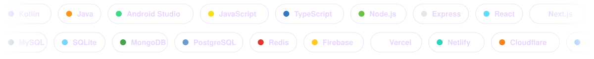
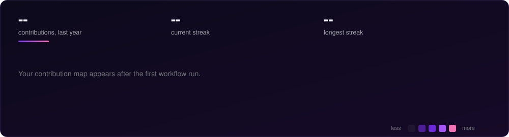
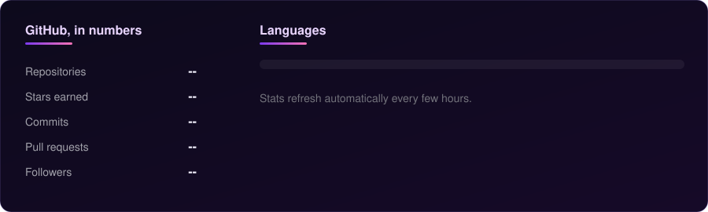
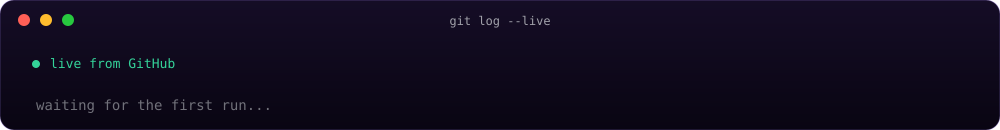

  

  

### About

I'm Max. I build Android apps, license panels and small stores, and I care about how things look and feel, not only whether they work. Most of what's here started as something I wanted for myself and turned into a proper project.

I mostly work with Node.js, Kotlin, Next.js and PHP, and deploy on Vercel, Netlify, Cloudflare and Google Cloud.

### Stack

  

### Projects

  

### Activity

<picture>
  <source media="(prefers-color-scheme: dark)" srcset="https://raw.githubusercontent.com/kryvexo/kryvexo/output/github-snake-dark.svg" />
  <source media="(prefers-color-scheme: light)" srcset="https://raw.githubusercontent.com/kryvexo/kryvexo/output/github-snake.svg" />
  
</picture>

  

