

  


  

### About

I'm Max. I build Android apps, license panels and small stores, and I care a lot about how things look and feel, not only whether they work. Almost everything below started as something I wanted for myself and slowly turned into a proper project.

<table>
  <tr>
    <td width="50%" valign="top">

**Right now**

- Polishing MAX STUDIO and its listen-together mode
- Making AIRFLIX faster and cleaner
- Adding features to the MAX OWN panel

    </td>
    <td width="50%" valign="top">

**Reach me**

- Fastest: [Telegram @kryvexo](https://t.me/kryvexo)
- Work and demos: [maxown.online](https://maxown.online)
- Daily stuff: [Instagram @maxgotiissues](https://instagram.com/maxgotiissues)

    </td>
  </tr>
</table>

### Stack

  

### Projects

  

### Activity

<picture>
  <source media="(prefers-color-scheme: dark)" srcset="https://raw.githubusercontent.com/kryvexo/kryvexo/output/github-snake-dark.svg" />
  <source media="(prefers-color-scheme: light)" srcset="https://raw.githubusercontent.com/kryvexo/kryvexo/output/github-snake.svg" />
  
</picture>

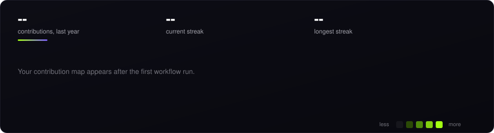


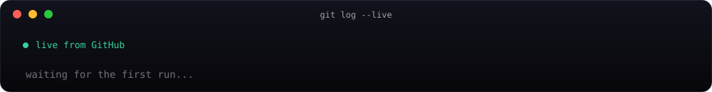

  <a href="https://ko-fi.com/maxown"></a>

